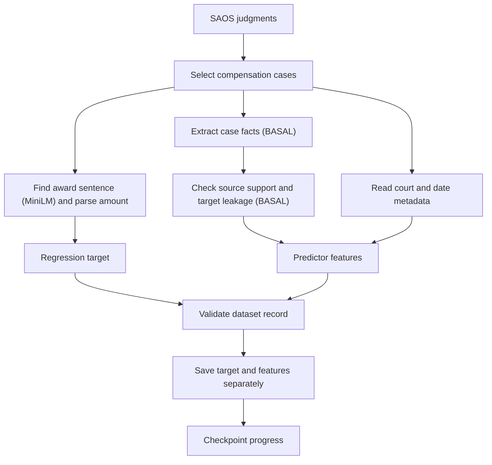

# SAOS Compensation

A project for estimating compensation awarded in Polish court judgments. The implemented pipeline downloads judgments from SAOS, selects compensation cases, extracts factual predictors and produces one monetary regression target per retained case.
PostgreSQL/pgvector ingestion, feature vectorization, regression training, evaluation and prediction are planned. Extracted records still need independent target and leakage review before training.

## Repository structure

Directories only; entries marked `not implemented` describe planned components and may not exist yet. Runtime caches and local outputs are shown without their generated contents.

```text
saos-compensation/
├── configs/                       # experiment configuration
│   └── dataset/                   # acquisition and future model-input configuration
│       └── acquisition/           # API, features, targets and Basal settings
├── src/                           # implementation
│   ├── dataset/                   # dataset preparation
│   │   ├── acquisition/           # SAOS access, downloads and checkpoints
│   │   ├── extraction/            # predictor extraction and validation
│   │   │   ├── model/             # model configuration, prompts and decision cache
│   │   │   ├── source/            # source normalization and passage selection
│   │   │   └── targets/           # monetary parsing and prior-payment extraction
│   │   ├── embeddings/            # text encoding and target sentence matching
│   │   ├── storage/               # local records, atomic writes and size limits
│   │   ├── database/              # PostgreSQL/pgvector ingestion — not implemented
│   │   └── vectorization/         # model-ready feature preprocessing — not implemented
│   ├── architectures/             # regression model definitions — not implemented
│   ├── training/                  # regression training — not implemented
│   ├── evaluation/                # regression metrics and error analysis — not implemented
│   └── inference/                 # compensation prediction — not implemented
├── tests/                         # automated checks
├── fixtures/                      # development snapshots
├── notebooks/                     # optional local experiments
├── data/                          # dataset placeholder
├── checkpoints/                   # model checkpoint placeholder
├── basal_weights/                 # local Basal weight cache
├── embedding_weights/             # local embedding weight cache
└── tmp/                           # default acquisition output and locality cache
```

## Setup

Requires Python 3.12 and [uv](https://docs.astral.sh/uv/). From the repository root, sync the environment for your platform:

```bash
# macOS with Apple MPS or CPU
uv sync --locked --extra pytorch-macos --group test

# Linux with NVIDIA CUDA
uv sync --locked --extra pytorch-cuda-linux --group test
```

For acquisition with Basal on CPU:

```bash
uv sync --locked --extra extraction --group test
```

For embeddings alone, use `uv sync --locked`. PyTorch and Transformers are base dependencies. Basal is optional: the platform extras above or the `extraction` extra install it for the full `get-data` pipeline. The test group adds pytest and may be omitted when only running acquisition. Execute subsequent commands with `uv run --no-sync` to use the installed environment without changing dependencies.

## Download and extract data

Run commands from the repository root:

```bash
uv run --no-sync get-data --help

# Small initial run: at most one dump page, containing up to 100 judgments
uv run --no-sync get-data --max-pages 1 --download-path tmp/dataset
```

This command downloads judgments and runs extraction. There is no download-only CLI mode. A page contains all judgment types; local filtering and extraction can leave few or no retained cases.

### Arguments

| Argument | Meaning |
|---|---|
| `-h`, `--help` | Show all command-line options and exit |
| `--config-dir PATH` | Directory containing the four acquisition YAML files; defaults to `configs/dataset/acquisition` |
| `--max-age-years N` | Include judgments from the last N years, anchored to the initial run date |
| `--max-pages N` | Maximum total dump pages across resumes; `0` reads all pages |
| `--max-gib N` | Total output-directory size limit in GiB across resumes; `0` disables it |
| `--download-path PATH` | Output directory relative to the project root |
| `--timeout SECONDS` | HTTP connection/read timeout |
| `--debug` | Add source/model-call diagnostics and retain eligible failed attempts |
| `--no-debug` | Disable debug output, overriding a true YAML default |

Explicit arguments override only their corresponding YAML settings. After setup, `uv run get-data --help` also works; the examples use `--no-sync` to keep dependency synchronization separate from execution.

## How get-data pipeline works

1. Download judgments from SAOS and keep relevant compensation cases.
2. Find the awarded amount using sentence matching and monetary parsing.
3. Extract case facts and check their source support and target leakage.
4. Save accepted records and checkpoint progress for resuming later.



## Configs

The implemented configuration and models currently serve data scraping and extraction only. Regression training, evaluation and prediction are not implemented.

The default configuration directory is `configs/dataset/acquisition/`:

| File | Controls |
|---|---|
| `api.yaml` | Acquisition dates, page and size limits, output path, debug and HTTP timeout |
| `features.yaml` | Selected metadata/numeric predictors and text extraction questions |
| `targets.yaml` | Embedding model/device, candidate keywords, similarity threshold and target/exclusion patterns |
| `basal.yaml` | Basal model/device and extraction/review thresholds |

The current acquisition defaults are:

| Setting | Default | Meaning |
|---|---|---|
| `max_age_years` | `10` | Inclusive judgment-date range ending on the initial run date |
| `max_pages` | `0` | No page limit; otherwise stop at this total page position across resumes |
| `max_gib` | `0.5` | Total output-directory limit across runs; `0` disables it |
| `download_path` | `tmp/` | Output directory relative to the project root (likely to be replaced with database) |
| `debug` | `true` | Add source/model-call files and retain eligible failed attempts |
| `timeout` | `20` | HTTP connection/read timeout in seconds |

Explicit CLI arguments override only the corresponding acquisition defaults:

```bash
uv run --no-sync get-data \
  --max-age-years 5 \
  --max-pages 2 \
  --max-gib 1 \
  --download-path tmp/dataset-five-years \
  --timeout 30 \
  --no-debug
```

`--debug` enables diagnostics and `--no-debug` overrides a true YAML default. `--config-dir path/to/config` selects another directory containing all four acquisition YAML files. Model and feature settings are changed in YAML.

### Models and devices

The current models are:

- **Remek/basal-2.0-4.5B:** extracts predictors and reviews factuality, relevance and leakage. `basal.yaml` can alternatively select the supported `Remek/basal-2.0-mini` checkpoint. Revisions are pinned in code.
- **sentence-transformers/paraphrase-multilingual-MiniLM-L12-v2:** embeds target patterns and eligible monetary sentences to select a judgment amount sentence.

Missing model files download automatically from Hugging Face and are reused from `basal_weights/` and `embedding_weights/`. Keep these caches outside a size-limited output directory. Locality population enrichment also downloads and caches a GUGiK snapshot under `tmp/gugik/`.

The default configuration selects `mps` in **both** `configs/dataset/acquisition/basal.yaml` and `configs/dataset/acquisition/targets.yaml`. Set both devices to `cpu` or `cuda` for another runtime. Unavailable accelerators fail before acquisition starts.

## Output and admission

```text
<download_path>/
├── checkpoint.json
└── <SAOS_ID>/
    ├── record.json         # selected predictor values only
    ├── award.json          # total and valid only
    ├── source.txt          # debug=true only
    └── model_calls.json    # debug=true only
```

`award.json` contains the one regression target `total` in PLN and the boolean `valid`. Normal output requires an admissible target and accepted source-backed text features. Debug can retain completed attempts with an unresolved target as `valid: false`, provided accepted text evidence exists. Cases with no accepted text feature are discarded even under debug. Missing judgment matches skip text-feature inference and therefore cannot meet this requirement. Source and leakage checks remain active for populated text fields. Training must filter for `valid: true` and independently assess label quality.

Debug adds only `source.txt` and `model_calls.json`; evidence and confidence diagnostics stay out of the two basic files. Rejected cases leave no final case files. Existing artifacts are preserved, so use a fresh output path for a clean dataset layout. Operational summaries are printed to the console.

## Resume and storage limits

Restart the same command after interruption. `checkpoint.json` pins the original date bounds, extraction configuration and locality snapshot hash, and records the next page/item. Saved records are recognized without repeating extraction. Temporary `<SAOS_ID>/pending/` state preserves source/configuration and completed model decisions even with debug disabled; it is removed after acceptance or rejection.

Dates, models, patterns, questions and extraction settings must remain compatible with the checkpoint. Use a new output path for a changed experiment or an older extractor version. The current extractor version is **26**. Debug, timeout, size and page limits may change during a resume; increasing the page limit continues acquisition. A fully completed checkpoint performs no further acquisition. Run one process per output directory.

`max_gib` includes existing output, debug files, pending state and atomic temporary writes across resumptions. A refused write stops the run with a resumable checkpoint; increase the limit to continue. A page limit follows dump order and is not random sampling.

## Checks

After syncing the test group:

```bash
uv run --no-sync pytest -q
```

Tests cover configuration, acquisition/checkpoints, extraction, monetary parsing, source/leakage checks and embeddings. Local notebook experiments are ignored; their tests skip when legacy inputs are absent.

## Reusable embeddings

```python
from src.dataset import load_config
from src.dataset.embeddings import create_embeddings

settings = load_config()["embedding"]
vectors = create_embeddings(["Opis szkody.", "Ograniczenia w pracy."], settings)
```

`create_embeddings` accepts a nonempty list of nonblank strings and encoder settings (`model`, `revision`, `device`, `batch_size`, `max_length`). It returns an `(N, D)` float32 PyTorch tensor on the selected device, preserving order and original text through all token windows. Encoder loading is lazy and cached for unchanged settings. Target matching applies its own monetary normalization before encoding.

## Current limitations and remaining work

Embedding similarity is not calibrated legal-role confidence. The matcher can select the wrong payment or miss an award, and fully written-out monetary amounts are unsupported. Currency recognition covers PLN, zł and grammatical forms of złoty and złotówka. Target matching splits at commas except those between digits. It ranks keyword-bearing fragments from full sentences containing PLN evidence, then expands money-free target seeds right first and left as fallback. Money-free seeds may start below threshold, and money-free growth must improve similarity; monetary growth may lower it but must remain strictly above the configured threshold and keep the same role ahead of exclusions. Growth stays within one sentence/paragraph and accepted left growth retries the right. The target covers only the final selected contiguous span, so separate awards elsewhere can be omitted. The changed matcher uses extractor version 27 and requires a new download path for older checkpoints. Extracted facts can still contain relevance or attribution errors despite automated checks.

Before training, manually label a representative sample, measure target/feature quality and review leakage. Then implement grouped train/validation/test splits, fit preprocessing only on training data, vectorize selected fields and train a simple regression baseline. Evaluate MAE/RMSE and errors across courts, regions, dates and target bands. Related judgments and appeals must share a split. PostgreSQL/JSONB/pgvector persistence and configurable alternative regressors remain future work.
