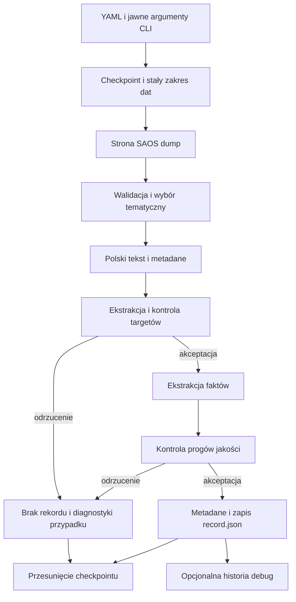

# Jak powstaje rekord zbioru SAOS

## Co robi model

Basal jest tu ekstraktorem informacji, a nie modelem przewidującym wysokość świadczenia. Czyta polski wyrok, rozpoznaje funkcję fragmentów, wybiera źródłowe opisy faktów i interpretuje wzmianki o kwotach. Model regresyjny uczący się przewidywania zadośćuczynienia nie jest jeszcze zaimplementowany.

`configs/dataset/basal.yaml` wybiera model przez identyfikator Hugging Face, np. `Remek/basal-2.0-mini`. Kod przypisuje obsługiwanym modelom konkretne rewizje. Nazwa odpowiada katalogowi `basal_weights/models--Remek--basal-2.0-mini/`. Brakujące pliki są pobierane automatycznie przez bibliotekę Hugging Face przy rozpoczęciu ekstrakcji; sam import pakietu ani PyTorch nie pobiera wag. `.gitkeep` zachowuje katalog w repozytorium; pozostała zawartość jest ignorowana.

Instrukcje, opisy pól i tekst wyroku są po polsku. Nazwy cech są angielskie: `event_circumstances`, `harm_type`, `harm_severity_duration`, `life_impact`, `claimant_circumstances`, `treatment_assistance`. Nazwa klucza schematu nie musi być w języku dokumentu. Celem jest wybór konkretnych zdań źródła, a nie swobodne dopisywanie okoliczności.

## Wejście i pobieranie

Wejściem programu jest konfiguracja YAML z ewentualnymi jawnymi nadpisaniami CLI. SAOS dump ogranicza daty wyroków; wybór sądów powszechnych i tekstów zawierających wzmiankę o zadośćuczynieniu oraz liczbową kwotę PLN odbywa się lokalnie. Pełne wyroki znajdują się już w stronach dumpu. Osobny słownik sądów pozwala połączyć ID wydziału z nazwą sądu.

HTML jest normalizowany do tekstu z granicami akapitów. Program sprawdza ID, datę, typ orzeczenia, sąd, sygnaturę i treść. Powtórzenia ID nie tworzą osobnych rekordów. Trafienie wyszukiwania lub regexu nie oznacza jeszcze poprawnego targetu.



## Ekstrakcja cech

Ten etap rozpoczyna się dopiero po ekstrakcji i dopuszczeniu targetu. Bez debug brak lub nieprawidłowy target kończy przetwarzanie przed oceną instancji i cech. Z debug zachowujemy każdą zakończoną próbę ekstrakcji, również gdy target jest brakujący, niepotwierdzony lub ma niską pewność. Cechy nadal przechodzą kontrolę wycieku, a brakujące wartości pozostają not_available.

1. Basal określa instancję na podstawie początku dokumentu. Poziom sądu nie zastępuje informacji o instancji.
2. Krótkie akapity są łączone w bloki do 1200 znaków. Zdania mieszczące się w limicie pozostają całe; dłuższe są dzielone przy spacji lub na granicy limitu. Mapowanie zachowuje dokładne pozycje źródłowe.
3. Basal wydobywa kandydatów na wybrane cechy bezpośrednio z bloków. Nie klasyfikujemy wcześniej wszystkich akapitów ani bloków. Wejście może zawierać fakty, stanowiska stron i rozważania; żaden kandydat nie jest jeszcze zaufaną cechą.
4. Wartości są rozszerzane do źródłowych zdań z zachowaniem osoby i negacji. Kandydaci są porządkowani według wyniku modelu.
5. Sprawdzamy tylko wybrane zdania: muszą zostać rozpoznane jako fakty z pewnością co najmniej `minimum_probability`, mieć wyciek nie większy niż `maximum_leak_probability` i nie zawierać oznaczeń waluty. Ocenę tego samego zakresu źródła współdzielimy między cechami. Jeśli kandydat odpada, sprawdzamy kolejnego.
6. Brak bezpiecznego kandydata oznacza brak informacji, a nie potwierdzenie, że dane zjawisko nie wystąpiło. Progi dopuszczenia targetu i kontroli wycieku pozostają bez zmian.


`judgment_year` pochodzi z daty SAOS. `court_locality_size` jest klasą populacji miejscowości, w której znajduje się sąd. Nazwa miejscowości jest dopasowywana do GUGiK przez Morfeusza, a klasa wynika z `LICZBAMIESZKANCOW`. Nie jest to populacja obszaru właściwości sądu ani miejsce zamieszkania powoda. Dopasowania niejednoznaczne pozostają brakujące. Nie znamy roku pomiaru ludności, więc współczesnego źródła nie należy traktować jako zweryfikowanych danych historycznych.

## Ekstrakcja kwot

Regex znajduje liczbową kwotę PLN, ale nie przypisuje jej znaczenia. Obsługiwane są m.in. grosze, separatory tysięcy i skale typu `tys.`, `mln`, `mld`. Kwoty zapisane w całości słownie nie są obsługiwane.

Dla każdego wystąpienia Basal otrzymuje całe zdanie lub punkt listy, jedną oznaczoną kwotę, poprzedzający kontekst i sentencję. Rozróżnia zasądzone zadośćuczynienie, jednorazowe odszkodowanie, nierozdzieloną sumę, pominięcie i niepewność. Kwoty żądane, wcześniejsze wypłaty, koszty procesu, odsetki i renta nie są targetami.

Powtórzeń tej samej wartości nie sumujemy. Jawny dowód z sentencji ma pierwszeństwo; konflikt wartości albo wielu beneficjentów wymaga odrzucenia lub przeglądu. Suma jest wyliczana tylko ze zgodnych, ustalonych składników. Osobne żądanie sprawdza całą propozycję wraz z dowodami.

## Ile jest przebiegów

Nie ma stałej liczby wywołań Basala. Dla dokumentu z cechami jest to w przybliżeniu:

`M + V + 1 + B + R`

- `1`: decyzja o instancji;
- `B`: porcje tekstu do bezpośredniej ekstrakcji kandydatów;
- `R`: kontrole zdań-kandydatów, współdzielone, gdy to samo zdanie pasuje do kilku pól;
- `M`: liczba wystąpień kwot;
- `V`: końcowa weryfikacja propozycji, zwykle 0 albo 1.

Dla odrzuconego targetu wykonujemy tylko `M + V`, bez pozostałych etapów. Wyjątek: debug zachowuje wszystkie zakończone próby, również z brakującym targetem, i wykonuje dla nich ekstrakcję cech.

To liczba żądań aplikacji, nie liczba wewnętrznych przebiegów sieci. Silnik może wykonywać kilka operacji dla jednego żądania. Wyłączenie cech tekstowych pomija ich ekstrakcję i kontrolę kandydatów. Czas zależy również od długości tekstu, urządzenia i modelu.

## Warunek zapisu

W zwykłym trybie rekord zostaje zapisany dopiero wtedy, gdy całe zasądzenie jest potwierdzone co najmniej na poziomie `amount_minimum_probability`, co najmniej jeden wybrany target ma ustaloną nieujemną wartość i użyte cytaty cech mają kontrolę wycieku zgodną z `maximum_leak_probability`.

Podczas obliczeń katalog `<ID>/pending/` przechowuje źródło, konfigurację i zakończone decyzje modelu. To tymczasowy stan wznowienia, również przy wyłączonym debugowaniu. Po przerwaniu te same żądania korzystają z zapisanych odpowiedzi; tylko przerwane wywołanie może wymagać powtórzenia. Bez debug po odrzuceniu katalog roboczy jest usuwany. Z debug najpierw zapisujemy cztery pliki sprawy, a dopiero potem usuwamy stan roboczy. Odrzucony przypadek nie pozostawia `record.json` ani diagnostyki sprawy. Tymczasowy stan wlicza się do max_gib. Strony dumpu z odrzuconymi wyrokami nie są zachowywane jako surowe pliki. Checkpoint i komunikaty konsoli nadal opisują postęp; ich techniczny rozmiar wlicza się do limitu całego katalogu. Nie da się zarazem zachować pliku w katalogu i nie liczyć jego rzeczywistych bajtów.

record.json zawiera wyłącznie cechy, a award.json wybrane targety, sumę i valid. valid=true oznacza target spełniający zwykłe warunki. Debug zachowuje też nieudane próby ekstrakcji jako valid=false; te rekordy nie mogą trafiać do treningu bez niezależnej weryfikacji. Przy debug: true dochodzą tylko source.txt i model_calls.json; przy false nie ma tych plików. Nie zapisujemy analysis.json, facts.txt, raportów ani kopii konfiguracji. Checkpoint i tymczasowe pending są stanem operacyjnym, nie danymi do modelu. Starsze pliki nie są automatycznie usuwane.

Poprzedni notebook także klasyfikował akapity osobno. Zapisany przebieg działał na MPS, a późniejszy wolny przebieg na CPU. Bieżący YAML wskazuje MPS dla tego Maca; CPU i CUDA pozostają dostępne. Nie jest to nowy pomiar szybkości ani dowód równoważnej jakości różnych modeli.

## Przykład poglądowy

To przykład syntetyczny, nie wynik pomiaru jakości modelu.

Wejście: „Powódka złamała nogę wskutek upadku na oblodzonym chodniku. Przez sześć tygodni chodziła o kulach”. W sentencji: „Zasądza 15 000 zł zadośćuczynienia i 2 000 zł odszkodowania”.

Po przejściu kontroli przykładowy rekord zawiera:

```json
{
  "features": {
    "event_circumstances": "Powódka złamała nogę wskutek upadku na oblodzonym chodniku.",
    "harm_type": "Powódka złamała nogę wskutek upadku na oblodzonym chodniku.",
    "harm_severity_duration": "Przez sześć tygodni chodziła o kulach"
  },
  "targets": {"zadoscuczynienie": "15000", "pozostale_odszkodowanie": "2000"},
  "total": "17000",
  "confirmed": true
}
```

Pełny rekord zawiera również ID sprawy, zbioru i uruchomienia, statusy oraz pozostałe wybrane cechy. Predyktory nie zawierają zdań o kwotach. Wysoki wynik kontroli Basala nie zastępuje ręcznie oznaczonej próby ani niezależnej oceny błędów.

## Stratyfikacja i zrównoważenie danych

Obecnie program nie równoważy zbioru. Kolejność ID i limit stron mogą silnie zniekształcać próbę; sama klasa populacji GUGiK nie zapewnia równowagi geograficznej.

Proponowany kolejny etap:

1. Ustalić populację badania i cel: reprezentatywność orzeczeń albo celowo wyrównaną próbę eksperymentalną. Są to różne rozkłady, więc nie należy traktować ich zamiennie.
2. Na zaakceptowanej puli policzyć liczebności i braki według roku, konkretnego sądu/regionu, poziomu, instancji i klasy populacji. Najpierw ocenić szerokie warstwy rok × region; drobne kombinacje szybko stają się puste.
3. Oznaczyć małą próbę rodzaju krzywdy i zdarzenia, ocenić jej ekstrakcję, a dopiero później używać kategorii do doboru danych. Nie tworzyć niewiarygodnych etykiet tylko dla równoważenia.
4. Powiązane postępowania i apelacje grupować przed podziałem. Test najlepiej wydzielić czasowo i pozostawić zgodny z naturalnym rozkładem. Wyrównywanie wykonać wyłącznie na treningu przez losowanie z zapisanym ziarnem lub wagi obserwacji.
5. Dla ciągłego targetu porównywać stałe pasma kwot i rozkład logarytmu kwoty, nie tworzyć klasyfikacji wyroków. Nie usuwać automatycznie rzadkich wysokich zasądzeń. Braki targetu nie są zerem.
6. Raportować MAE/RMSE i pokrycie osobno dla warstw oraz dla naturalnego testu. Równowaga liczebności nie dowodzi braku wycieku ani lepszej regresji.

Nie dodajemy jeszcze arbitralnych kwot ani wag do downloadera. Najpierw potrzebny jest audyt rozkładu i decyzja o docelowej populacji; limity rozmiaru, progi jakości i czasowy zakres pobierania same tego nie rozwiązują.
