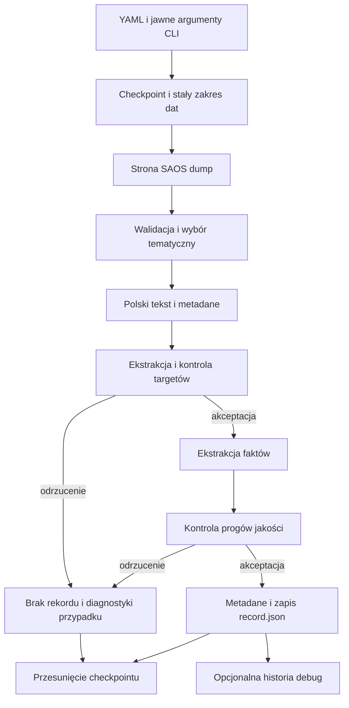

# Jak powstaje rekord zbioru SAOS

## Co robi model

Basal jest tu ekstraktorem informacji, a nie modelem przewidującym wysokość świadczenia. Czyta polski wyrok, rozpoznaje funkcję fragmentów, wybiera źródłowe opisy faktów i interpretuje wzmianki o kwotach. Model regresyjny uczący się przewidywania zadośćuczynienia nie jest jeszcze zaimplementowany.

`configs/dataset/basal.yaml` wybiera model przez identyfikator Hugging Face, np. `Remek/basal-2.0-mini`. Kod przypisuje obsługiwanym modelom konkretne rewizje. Nazwa odpowiada katalogowi `basal_weights/models--Remek--basal-2.0-mini/`. Brakujące pliki są pobierane automatycznie przez bibliotekę Hugging Face przy rozpoczęciu ekstrakcji; sam import pakietu ani PyTorch nie pobiera wag. `.gitkeep` zachowuje katalog w repozytorium; pozostała zawartość jest ignorowana.

Instrukcje, opisy pól i tekst wyroku są po polsku. Nazwy cech są angielskie: `event_circumstances`, `harm_type`, `harm_severity_duration`, `life_impact`, `claimant_circumstances`, `treatment_assistance`. Nazwa klucza schematu nie musi być w języku dokumentu. Celem jest wybór konkretnych zdań źródła, a nie swobodne dopisywanie okoliczności.

## Wejście i pobieranie

Wejściem programu jest konfiguracja YAML z ewentualnymi jawnymi nadpisaniami CLI. SAOS dump ogranicza daty wyroków; wybór sądów powszechnych i tekstów zawierających wzmiankę o zadośćuczynieniu oraz liczbową kwotę PLN odbywa się lokalnie. Pełne wyroki znajdują się już w stronach dumpu. Osobny słownik sądów pozwala połączyć ID wydziału z nazwą sądu.

HTML jest normalizowany do tekstu z granicami akapitów. Program sprawdza ID, datę, typ orzeczenia, sąd, sygnaturę i treść. Powtórzenia ID nie tworzą osobnych rekordów. Trafienie wyszukiwania lub regexu nie oznacza jeszcze poprawnego targetu.



## Ekstrakcja cech

Ten etap rozpoczyna się dopiero po ekstrakcji i dopuszczeniu targetu. Bez debug brak lub nieprawidłowy target kończy przetwarzanie przed oceną instancji i cech. Z debug zachowujemy każdą zakończoną próbę ekstrakcji, również gdy target jest brakujący, niepotwierdzony lub ma niską pewność. Jeśli nie ma dopasowania judgment, zapisujemy brakujące cechy bez dalszych wywołań Basala. W pozostałych przypadkach cechy nadal przechodzą kontrolę wycieku, a brakujące wartości pozostają not_available.

1. Basal określa instancję na podstawie początku dokumentu. Poziom sądu nie zastępuje informacji o instancji.
2. Najpierw wybieramy ustalenia faktyczne sądu na podstawie nagłówków, np. „Sąd ustalił, co następuje”. Obsługiwany jest też wspólny nagłówek „Sąd ustalił i zważył”. Bez takiego nagłówka pierwszym źródłem jest treść uzasadnienia przed rozważaniami, jeżeli da się wyznaczyć tę granicę.
3. Sąsiadujące zdania są łączone w porcje do 6000 znaków, z dokładnym mapowaniem do źródła. Wszystkie wybrane pola są wydobywane razem. Nie klasyfikujemy wcześniej każdego akapitu.
4. Sprawdzamy wybrane zdania: faktyczność i jej pewność, brak oznaczeń waluty, wyciek targetu oraz dopasowanie do konkretnego pola. Prawdziwe zdanie o leczeniu nie wystarcza jako opis okoliczności wypadku. W jednym żądaniu współdzielimy kontrolę źródła i oceniamy dopasowanie do pól, dla których ten sam cytat jest kandydatem.
5. Gdy kandydat nie przechodzi kontroli, sprawdzamy kolejnego. Do pozostałej treści wracamy tylko po brakujące pola; zaakceptowanych nie wydobywamy ponownie. Brak bezpiecznego, pasującego opisu pozostaje brakiem informacji.


`judgment_year` pochodzi z daty SAOS. `court_locality_size` jest klasą populacji miejscowości, w której znajduje się sąd. Nazwa miejscowości jest dopasowywana do GUGiK przez Morfeusza, a klasa wynika z `LICZBAMIESZKANCOW`. Nie jest to populacja obszaru właściwości sądu ani miejsce zamieszkania powoda. Dopasowania niejednoznaczne pozostają brakujące. Nie znamy roku pomiaru ludności, więc współczesnego źródła nie należy traktować jako zweryfikowanych danych historycznych.

## Wybór zdań targetu i ekstrakcja kwot

embedding.yaml wybiera mały model sentence-transformers/paraphrase-multilingual-MiniLM-L12-v2, jego przypiętą rewizję, urządzenie CPU/MPS/CUDA i minimum_cosine_similarity: 0.7. Wagi są w embedding_weights/, oddzielnie od basal_weights/.

Wzorce z target_pattern.yaml są kodowane raz. Najpierw tani filtr wybiera tylko zdania zawierające jednocześnie liczbową kwotę PLN z walutą i rdzeń słowa z candidate_keywords. Rdzenie są dopasowywane od początku słowa, bez rozróżniania wielkości liter. Rdzenie judgment/request ograniczają dopuszczalną klasę. Grupa shared dopuszcza obie klasy tylko przy braku rdzeni wskazujących rolę; obecność rdzeni obu ról również pozostawia obie klasy do porównania. Dopiero kandydaci otrzymują embedding w batchach i wynik cosine similarity względem dopuszczalnych wzorców. Bez kandydatów nie ładujemy modelu embeddingowego. Kwoty zapisane wyłącznie słownie pozostają nieobsługiwane. Zdanie trafia do silniejszej klasy; remis między klasami oznacza wstrzymanie decyzji. W każdej klasie wygrywa najwyższy wynik spełniający próg. Request jest opcjonalny, judgment jest wymagany do poprawnego rekordu. Długie zdania są kodowane we wszystkich oknach tokenów, bez pomijania końcówki. Treść źródła i pozycje kwot pozostają niezmienione.

Podobieństwo nie jest prawdopodobieństwem poprawnej interpretacji prawnej. MiniLM może uznać żądanie lub wcześniejszą wypłatę za podobne do zasądzenia. Basal nie wyszukuje już roli targetu w całym tekście, lecz ustala składniki i kwoty w wybranym zdaniu oraz jego sentencji, jeśli granica sentencji jest dostępna. Koszty, odsetki i renta są wykluczane. Brak jednoznacznej kwoty pozostaje brakiem informacji.

Obsługujemy wielu poszkodowanych: jeden rekord zawiera łączną kwotę świadczeń. „Po 20 000 zł” dla dwóch osób oznacza 40 000 zł; wspólne 20 000 zł dla dwóch osób pozostaje 20 000 zł. Osobne obowiązki zapłaty są sumowane, a odbiorcy deduplikowani. Nie mnożymy kwoty, jeśli grupa odbiorców pozostaje niejednoznaczna. Liczba odbiorców świadczenia jest cechą injured_party_count.

Kwota request jest zapisywana w award.json tylko wtedy, gdy wybrane zdanie zawiera jedną jednoznaczną kwotę PLN; inaczej pozostaje not_available. Nie jest predyktorem. Końcowe potwierdzenie kwoty przez Basala ma własny próg z basal.yaml, niezależny od podobieństwa 0,7.

## Ile jest przebiegów

Nie ma stałej liczby wywołań Basala. Dla dokumentu z cechami jest to w przybliżeniu:

`1 + M + V + 1 + B + R`

- `1`: decyzja o instancji;
- `B`: porcje ustaleń faktycznych oraz ewentualny drugi przebieg tylko dla brakujących pól;
- `R`: kontrole zdań-kandydatów, współdzielone, gdy to samo zdanie pasuje do kilku pól;
- pierwsze `1`: ekstrakcja odbiorców świadczenia;
- `M`: liczba kwot w dopasowanym zdaniu i jego sentencji;
- `V`: końcowa weryfikacja propozycji, zwykle 0 albo 1.

Przy braku judgment nie wykonujemy wywołań Basala. Dla odrzuconej propozycji kwoty wykonujemy tylko `1 + M + V`, bez pozostałych etapów. Wyjątek: debug zachowuje wszystkie zakończone próby, również z brakującym targetem, i wykonuje dla nich ekstrakcję cech.

To liczba żądań aplikacji, nie liczba wewnętrznych przebiegów sieci. Silnik może wykonywać kilka operacji dla jednego żądania. Wyłączenie cech tekstowych pomija ich ekstrakcję i kontrolę kandydatów. Czas zależy również od długości tekstu, urządzenia i modelu.

## Warunek zapisu

W zwykłym trybie rekord zostaje zapisany dopiero wtedy, gdy całe zasądzenie jest potwierdzone co najmniej na poziomie `amount_minimum_probability`, co najmniej jeden wybrany target ma ustaloną nieujemną wartość i użyte cytaty cech mają kontrolę wycieku zgodną z `maximum_leak_probability`.

Podczas obliczeń katalog `<ID>/pending/` przechowuje źródło, konfigurację i zakończone decyzje modelu. To tymczasowy stan wznowienia, również przy wyłączonym debugowaniu. Po przerwaniu te same żądania korzystają z zapisanych odpowiedzi; tylko przerwane wywołanie może wymagać powtórzenia. Bez debug po odrzuceniu katalog roboczy jest usuwany. Z debug najpierw zapisujemy cztery pliki sprawy, a dopiero potem usuwamy stan roboczy. Odrzucony przypadek nie pozostawia `record.json` ani diagnostyki sprawy. Tymczasowy stan wlicza się do max_gib. Strony dumpu z odrzuconymi wyrokami nie są zachowywane jako surowe pliki. Checkpoint i komunikaty konsoli nadal opisują postęp; ich techniczny rozmiar wlicza się do limitu całego katalogu. Nie da się zarazem zachować pliku w katalogu i nie liczyć jego rzeczywistych bajtów.

record.json zawiera wyłącznie cechy, a award.json wybrane targety, sumę i valid. valid=true oznacza target spełniający zwykłe warunki. Debug zachowuje też nieudane próby ekstrakcji jako valid=false; te rekordy nie mogą trafiać do treningu bez niezależnej weryfikacji. Przy debug: true dochodzą tylko source.txt i model_calls.json; przy false nie ma tych plików. Nie zapisujemy analysis.json, facts.txt, raportów ani kopii konfiguracji. Checkpoint i tymczasowe pending są stanem operacyjnym, nie danymi do modelu. Starsze pliki nie są automatycznie usuwane.

Poprzedni notebook także klasyfikował akapity osobno. Zapisany przebieg działał na MPS, a późniejszy wolny przebieg na CPU. Bieżący YAML wskazuje MPS dla tego Maca; CPU i CUDA pozostają dostępne. Nie jest to nowy pomiar szybkości ani dowód równoważnej jakości różnych modeli.

## Przykład poglądowy

To przykład syntetyczny, nie wynik pomiaru jakości modelu.

Wejście: „Powódka złamała nogę wskutek upadku na oblodzonym chodniku. Przez sześć tygodni chodziła o kulach”. W sentencji: „Zasądza 15 000 zł zadośćuczynienia i 2 000 zł odszkodowania”.

Po przejściu kontroli przykładowy rekord zawiera:

record.json:

```json
{
  "event_circumstances": "Powódka upadła na oblodzonym chodniku.",
  "harm_type": "Powódka doznała złamania nogi.",
  "harm_severity_duration": "Przez sześć tygodni chodziła o kulach."
}
```

award.json:

```json
{
  "zadoscuczynienie": "15000",
  "pozostale_odszkodowanie": "2000",
  "total": "17000",
  "valid": true
}
```

To przykład formatu, nie wynik pomiaru jakości. Predyktory nie zawierają zdań o kwotach. Wysoki wynik kontroli Basala nie zastępuje ręcznie oznaczonej próby ani niezależnej oceny błędów.

## Stratyfikacja i zrównoważenie danych

Obecnie program nie równoważy zbioru. Kolejność ID i limit stron mogą silnie zniekształcać próbę; sama klasa populacji GUGiK nie zapewnia równowagi geograficznej.

Proponowany kolejny etap:

1. Ustalić populację badania i cel: reprezentatywność orzeczeń albo celowo wyrównaną próbę eksperymentalną. Są to różne rozkłady, więc nie należy traktować ich zamiennie.
2. Na zaakceptowanej puli policzyć liczebności i braki według roku, konkretnego sądu/regionu, poziomu, instancji i klasy populacji. Najpierw ocenić szerokie warstwy rok × region; drobne kombinacje szybko stają się puste.
3. Oznaczyć małą próbę rodzaju krzywdy i zdarzenia, ocenić jej ekstrakcję, a dopiero później używać kategorii do doboru danych. Nie tworzyć niewiarygodnych etykiet tylko dla równoważenia.
4. Powiązane postępowania i apelacje grupować przed podziałem. Test najlepiej wydzielić czasowo i pozostawić zgodny z naturalnym rozkładem. Wyrównywanie wykonać wyłącznie na treningu przez losowanie z zapisanym ziarnem lub wagi obserwacji.
5. Dla ciągłego targetu porównywać stałe pasma kwot i rozkład logarytmu kwoty, nie tworzyć klasyfikacji wyroków. Nie usuwać automatycznie rzadkich wysokich zasądzeń. Braki targetu nie są zerem.
6. Raportować MAE/RMSE i pokrycie osobno dla warstw oraz dla naturalnego testu. Równowaga liczebności nie dowodzi braku wycieku ani lepszej regresji.

Nie dodajemy jeszcze arbitralnych kwot ani wag do downloadera. Najpierw potrzebny jest audyt rozkładu i decyzja o docelowej populacji; limity rozmiaru, progi jakości i czasowy zakres pobierania same tego nie rozwiązują.
